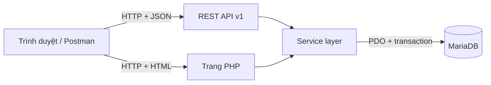

# Kiến trúc hướng dịch vụ của hệ thống

Hệ thống là **modular monolith nhiều tầng** viết bằng PHP 8.2 và MariaDB. REST API là lớp giao tiếp dịch vụ; nghiệp vụ vẫn tập trung trong `services/` để trang PHP và API dùng chung, tránh hai cách xử lý khác nhau cho cùng một use case.

## Thành phần

| Thành phần | Trách nhiệm |
|---|---|
| `api/index.php` | Routing, HTTP method/status, JSON và kiểm tra đầu vào |
| `services/` | Quy tắc nghiệp vụ, truy vấn có tham số và transaction |
| `includes/auth.php` | Session và xác thực tài khoản |
| `includes/permissions.php` | Phân quyền theo vai trò |
| `services/csrf.php` | CSRF cho form và API ghi dữ liệu |
| `api/openapi.yaml` | Hợp đồng OpenAPI 3.0 |
| `tests/kiem_thu_api.py` | Integration test qua HTTP |

## Nguyên tắc REST được áp dụng

- URI đại diện tài nguyên: trường, kỳ thi, điểm thi và phòng thi.
- `GET` chỉ đọc; thao tác chuẩn bị phòng dùng `POST` và transaction.
- Phản hồi thống nhất dạng `{ "success": true, "data": ... }` hoặc `{ "success": false, "error": ... }`.
- Status code phân biệt thành công, sai đầu vào, chưa đăng nhập, thiếu quyền, lỗi nghiệp vụ và database chưa sẵn sàng.
- API stateless ở lớp request/response nhưng dùng session cookie hiện có cho xác thực cùng nguồn.
- API ghi yêu cầu cả vai trò hợp lệ và `X-CSRF-Token`.

## Phạm vi và hướng mở rộng

Phiên bản 1 chủ ý nhỏ để phù hợp đồ án. Hệ thống chưa cần API Gateway, service registry, message broker, MongoDB hoặc tách microservice. Khi có client độc lập hoặc tải tăng rõ rệt, có thể tách từng miền như tổ chức thi hay chấm thi sau khi xác định ranh giới dữ liệu và giao dịch.
